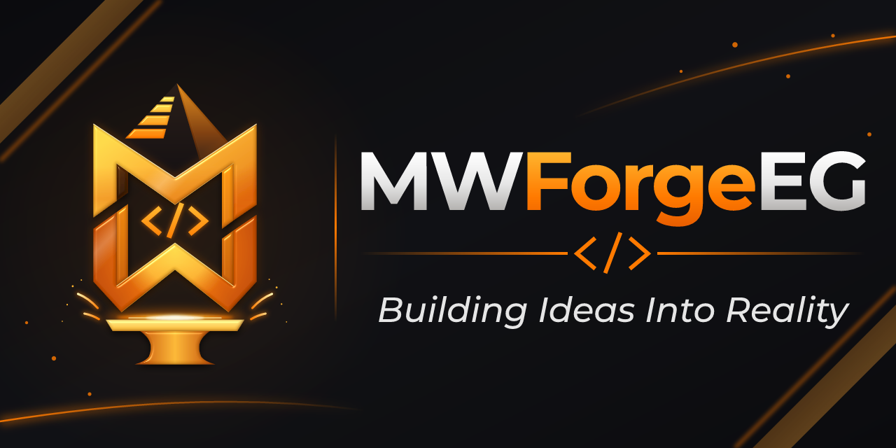

  

<h1 align="center">Hi, I'm Mohammed Wagdy 👋</h1>

  <strong>MWForgeEG | Building Ideas Into Reality 🇪🇬</strong>

  Software Engineering · Agile · AI &amp; Automation · Egypt

## About me

I'm **Mohammed Wagdy**. I like turning ideas into practical, maintainable digital solutions, and my work sits where software engineering, agile delivery and automation meet.

## What MWForgeEG stands for

- **MW**: Mohammed Wagdy
- **Forge**: building, crafting and refining solutions
- **EG**: Egypt 🇪🇬

> Building Ideas Into Reality

## Focus areas

- Software engineering
- Agile and product delivery
- AI and automation
- Workflow design and process improvement

---

   
  <strong>Build · Code · Forge · Innovate</strong>

